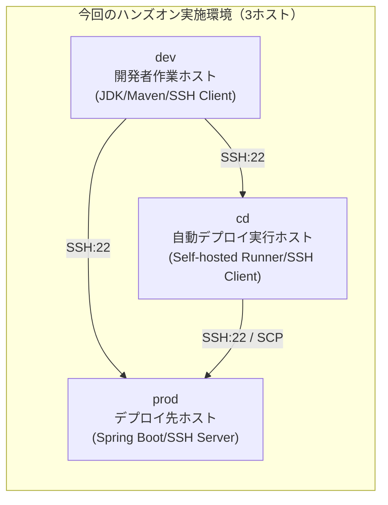

# 手を動かして理解する自動デプロイ基礎ハンズオン


## 概要

このリポジトリは、勉強会「手を動かして理解する自動デプロイ基礎ハンズオン」向けの教材です。  
まずは SSH / SCP を使って手動デプロイを体験し、その後に GitHub Actions で同じ流れを自動化していきます。

## ハンズオン実施環境
本ハンズオンは、当リポジトリを各自がインポートして、GitHub Code Spaces 上で開発環境を構築することを想定しています。

## アーキテクチャー構成（今回のハンズオン実施環境）

> このハンズオンでは、**dev / prod / cd の3ホスト**を使って進行します。



なお、開発者作業ホストの8080番ポートは、ポート転送で作業環境の8080番ポートにマッピングされてます。デプロイ先ホストの8080番ポートについても、作業環境側に転送されており、こちらは18080番ポートにマッピングされています。

## 動作環境

### 開発環境(dev)

- **OS/実行環境**: Ubuntu 26.04
- **使用ユーザー**: `dev`
- **言語/実行基盤**: Java 25 (JDK)
- **フレームワーク**: Spring Boot 4.2
- **ビルド**: Maven (`./mvnw`)
- **データベース**: SQLite (`app.db`)
- **補足**: `prod` / `cd` に SSH 接続可能

### 本番環境(prod)

- **OS**: Ubuntu 26.04
- **使用ユーザー**: `deployer`
- **アプリ実行ディレクトリ**: `/app`
- **Java**: 25
- **Spring Boot**: 4.2
- **データベース**: SQLite (`app.db`)
- **公開ポート**: `18080 -> 8080`

### GitHub Actions セルフホストランナー環境(cd)

- **OS**: Ubuntu 26.10
- **使用ユーザー**: `runner`
- **セルフホストランナー実行ディレクトリ**: `actions-runner`
- **主用途**: 自動デプロイ
- **ランナー**: GitHub Actions self-hosted runner
- **補足**: `prod` に SSH 接続可能

## ハンズオンの進め方

このハンズオンは、次の順番で実施します。

1. SSHを理解する
   - SSH 接続の基本を理解する（`dev -> prod` / `dev -> cd`）
   - 既存の `cd -> prod` SSH を動かして仕組みを確認する
   - SSH ファイルを削除し、受講者自身で `cd -> prod` 接続を再構築する
2. 手動デプロイを実施してみる
   - `feat/birthday-web-app` からチェリーピックで変更を取り込む
   - デプロイ対象アプリを理解する（SQLite / ログ / デバッグ）
   - 手動デプロイを実施し、2回目以降の再デプロイ手順まで確認する
3. 自動デプロイに挑戦する
   - GitHub Actions のセルフホストランナー登録を行う
   - 自動デプロイを実行し、結果を検証する

---

## 1. SSHの基本を理解する

### 1-1. まず接続してみる

`dev` から次を実行します。

```bash
ssh deployer@prod
ssh runner@cd
```

期待値:

- `deployer@prod` で `prod` 側シェルに入れる
- `runner@cd` で `cd` 側シェルに入れる

### 1-2. `-v` オプションで鍵認証の流れを見る

認証の中身を見たいときは `-v` を使います。

```bash
ssh -v deployer@prod
ssh -v runner@cd
```

確認ポイント:

- どの鍵ファイルを試しているか（`identity file ...`）
- どのホスト鍵で接続しているか
- 最終的に `Authentication succeeded` になるか

### 1-3. `.ssh` ディレクトリを見る

SSH が何を参照しているかを実ファイルで確認します。

```bash
ls -la ~/.ssh
cat ~/.ssh/config
```

主に見るファイル:

- `id_ed25519`（秘密鍵）
- `id_ed25519.pub`（公開鍵）
- `config`（`prod` / `cd` の接続先別設定）
- `known_hosts`（接続済みホスト鍵）

---

## 2. 既存の `cd -> prod` SSH を動かして確認する

既に設定済みの状態で、`cd` から `prod` に接続できることを確認します。

```bash
ssh runner@cd 'ssh -v deployer@prod "hostname && whoami"'
```

期待値:

- `prod`
- `deployer`

---

## 3. SSHファイルを削除し、自分で `cd -> prod` を再構築する

この手順で、鍵認証の構成を受講者自身で作れる状態にします。

### 3-1. `cd` 上の `.ssh` を確認

```bash
ssh runner@cd 'ls -la ~/.ssh'
```

### 3-2. 必要ファイルを削除

```bash
ssh runner@cd 'rm -f ~/.ssh/id_ed25519 ~/.ssh/id_ed25519.pub ~/.ssh/config ~/.ssh/known_hosts'
```

### 3-3. `cd` 上で鍵ペアを新規作成

```bash
ssh runner@cd 'ssh-keygen -t ed25519 -N "" -f ~/.ssh/id_ed25519'
```

### 3-4. `cd` 側の `~/.ssh/config` を作成

```bash
ssh runner@cd 'cat > ~/.ssh/config << "EOF"
Host prod
    HostName prod
    User deployer
    StrictHostKeyChecking accept-new
EOF
chmod 600 ~/.ssh/config'
```

.sshに配置するファイルは、権限を適切に設定する必要があります。Linuxでは、権限を3桁の数字で表します。この数字は、左から1桁ずつ、所有者・グループ・その他のユーザーに対する権限を示します。数字そのものの意味は以下の通りです。

- 4: 読み取り権限
- 2: 書き込み権限
- 1: 実行権限

例えば、`chmod 600 ~/.ssh/config` は所有者に読み取り・書き込み権限を与え、グループとその他のユーザーには権限を与えない設定です。

### 3-5. `cd` の公開鍵を `prod` に登録

```bash
PUBKEY=$(ssh runner@cd 'cat ~/.ssh/id_ed25519.pub')
ssh deployer@prod "mkdir -p ~/.ssh && chmod 700 ~/.ssh && echo '$PUBKEY' >> ~/.ssh/authorized_keys && chmod 600 ~/.ssh/authorized_keys"
```

### 3-6. 再接続テスト

```bash
ssh runner@cd 'ssh deployer@prod "hostname && whoami"'
```

---

## 4. `feat/birthday-web-app` のチェリーピックで開発内容を取り込む

受講生はゼロから実装するのではなく、`feat/birthday-web-app` のコミットを段階的に取り込みます。

### 4-1. 対象コミットを探す

VSCode拡張機能の`Git Graph` を使います。Git Graph を開いて、取得したいコミットを右クリックから `Cherry-pick` で取り込んでください。

### 4-2. 今回のWebアプリの開発状況

今回は、5つの主要なコミットを段階的にチェリーピックして開発内容を取り込みます。

- `feat(サンプルアプリ): JavaのサンプルWebアプリ実装を追加`
- `feat(サンプルアプリ): 基盤設定とトップページを整備`
- `feat(サンプルアプリ): 誕生日管理メモを開発中ページに接続`
- `feat(サンプルアプリ): 誕生日一覧ページを実装`
- `feat(サンプルアプリ): 誕生日詳細ページと追加・編集機能を実装`

なお、この章で、全てのチェリーピックを行うわけではありません。まずは、1つ目のチェリーピックを実施して、次の手動デプロイの章に進んでください。
※ `test(サンプルアプリ): 誕生日管理メモ機能のテストを追加`はテストコードの追加のため、プロダクションコードに変更はありません。

---

## 5. デプロイ対象アプリの把握（SQLite / ログ / デバッグ）

### 5-1. SQLite の使用

アプリは SQLite を利用します。DB ファイルは `app.db` です。
最初の段階では、`app.db` ファイルは存在しませんが、開発の過程でアプリが自動的に作成します(4つ目のコミット)。

### 5-2. ログファイル出力を確認

アプリログは `logs/app_yyyyMMdd.log` に日次ローテーションで出力されます。

### 5-3. F5 でデバッグ実行

VS Code では [launch.json](/workspace/.vscode/launch.json) が設定されているため、 F5 デバッグ実行できます。
このデバッグ実行では、Webアプリは、8080番ポートで動作するように設定されています。
実際のWebアプリの挙動を確認したい場合は、デバッグ実行の上、ポート転送先のブラウザへアクセスしてください。

---

## 6. 手動デプロイ（`.github/workflows/cd.yml` 相当の手順）

### 6-1. Jar 作成

開発環境で以下のコマンドから Jar ファイルを作成します。

```bash
./mvnw clean package -DskipTests
```

### 6-2. Jar 転送

SSHを使ってファイルを転送できるSCPコマンドを使って、作成した Jar ファイルをサーバーの `/app/app.jar` に配置します。

```bash
scp target/demo-0.0.1.jar deployer@prod:/app/app.jar
```

### 6-3. バックグラウンド起動（`nohup`）

SSHでサーバーに接続して、バックグラウンドでアプリを起動します。

```bash
ssh deployer@prod 'bash -lc "nohup java -jar /app/app.jar </dev/null >/dev/null 2>&1 & echo JAVA_PID=\$! && sleep 3"'
```

### 6-4. 起動確認

Webアプリの動作を確認しましょう。prod環境の8080番ポートは作業環境の転送ポート（例: 18080）を通じてアクセス可能です。

### 6-5 2回目以降のデプロイは以下の考慮も必要です。

#### 6-5-1. バックアップ（既存 Jar）

SSHでサーバーに接続し、デプロイ先ディレクトリである、`/app` に移動して既存の Jar をバックアップします。

```bash
ssh deployer@prod 'bash -lc "mkdir -p /app/backup && cp /app/app.jar /app/backup/app.jar.$(date +%Y%m%d_%H%M%S).bak || true"'
```

#### 6-5-2. 既存 Java プロセス停止

```bash
ssh deployer@prod 'pgrep -u "$USER" -x java'
```

```bash
ssh deployer@prod 'kill -15 <確認した PID>'
```

なお、上記でプロセスが停止しない場合は、以下を実行します。

```bash
ssh deployer@prod 'kill -9 <確認した PID>'
```

### 6-5-3. 新しい Jar 配置とアプリ再起動
6-1から6-4の手順を繰り返して、新しい Jar を配置し、アプリを再起動します。

---

## 7. GitHub Actions セルフホストランナー登録

セルフホストランナーは、**GitHubブラウザ画面の設定から登録**します。

1. GitHub リポジトリを開く
2. `Settings` -> `Actions` -> `Runners`
3. `New self-hosted runner` を押す
4. 表示されるLinux用登録コマンドを `cd` ホスト側の`/actions-runner` に移動して実行する
※GitHubブラウザ画面で表示される登録コマンドだけでは、セッションが切断された場合に、ランナーの登録が外れるため、必要に応じて、接続を維持するか、`nohup` 等を使ってバックグラウンドで実行してください。

---

## 8. GitHub Actions動作確認

### 8-1. 動作確認ワークフローの取り込み

` ci/add-deploy-workflow`ブランチから以下のコミットをチェリーピックして取り込みます。

- `ci(自動デプロイ): 自動デプロイのサンプルワークフローを追加`

### 8-2. トリガー

- 任意のブランチへの push
- `workflow_dispatch`（手動実行）

### 8-3. 実行後確認

GitHubのリポジトリのブラウザ画面で、Actions タブを開き、ワークフローが正しく実行されていることを確認します。

## 9. 自動デプロイ実施

### 9-1. 動作確認ワークフローの取り込み
` ci/add-deploy-workflow`ブランチから以下のコミットをチェリーピックして取り込みます。

- `ci(自動デプロイ): 自動デプロイのワークフローを追加`

### 9-2. トリガー

- `main` への push
- `workflow_dispatch`（手動実行）

### 9-3. build ジョブ（GitHub-hosted）

- `actions/checkout`
- `actions/setup-java` で JDK 25 を構築
- `./mvnw clean package -DskipTests` で Jar 作成
- `actions/upload-artifact` で `target/*.jar` を保存

### 9-4. deploy ジョブ（self-hosted on cd）

- `actions/download-artifact` で Jar 取得
- 既存 Jar を `/app/backup` にバックアップ
- `scp` で `/app/app.jar` に配置
- Java プロセスを停止（graceful -> 必要なら kill -9）
- `nohup java -jar /app/app.jar` でバックグラウンド再起動
- `pgrep` で再起動確認

### 9-5. 必要な Secrets
GitHub Actions のワークフローに機密情報を記載することがないよう、ホスト名やユーザー名は Secrets を利用して管理します。
Secrets に設定は、ブラウザ画面または、VSCCode の GitHub Actions 拡張機能から行うことが可能です。

- `DEPLOY_USER`（例: `deployer`）
- `DEPLOY_HOST`（例: `prod`）

### 9-6. 実行後確認

1. Actions 画面で `build` / `deploy` が成功
2. 必要に応じて VS Code の転送ポート `18080` で画面表示を確認

以上。
